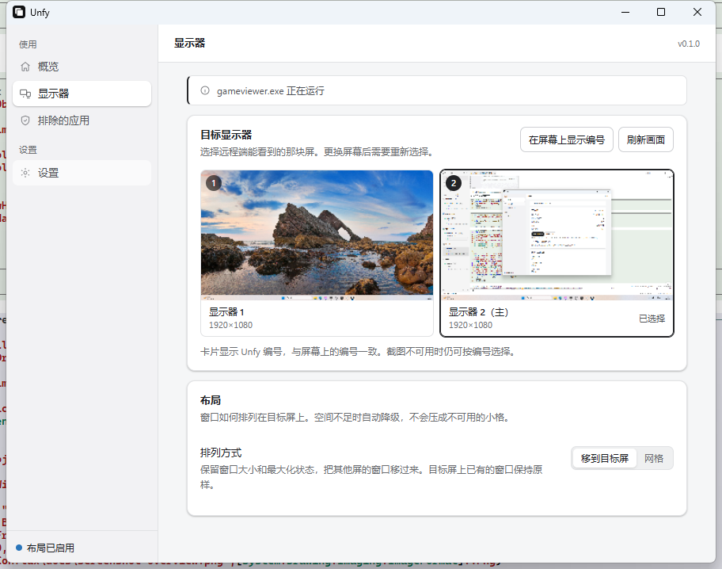

<div align="center">


# Unfy

**把多显示器主机的窗口，收拢到远程客户端能看到的那一块屏。**

用单屏笔记本远程连回多屏主机时，其他屏幕上的窗口都在视野之外。<br>
Unfy 把它们移到你能看见的屏幕上，并在结束后按快照放回原位。

[](https://github.com/Xinzhe99/unfy/actions/workflows/ci.yml)
[](https://github.com/Xinzhe99/unfy/releases)
[](https://github.com/Xinzhe99/unfy/releases)
[](LICENSE)
[](#平台支持)

[下载](#下载) · [功能](#功能) · [工作原理](#工作原理) · [常见问题](#常见问题) · [开发](#开发)

</div>



## 它解决什么问题

主机接了三块屏。你用只有一块屏的笔记本，通过远程软件连回来，画面里只有其中一块。另外两块屏上的浏览器、编辑器、聊天窗口，你既看不见也点不到，只能断开重连或者盲猜快捷键。

远程软件自己提供的「切换显示器」按钮能缓解，但要每次手动切。Unfy 的做法是：**把窗口搬到你能看见的那块屏上，用完再搬回去。**

## 功能

### 一键收拢，保留窗口原状

选择远程画面里能看到的那块屏，点一下整理。窗口按原有大小和相对位置移过去，最大化窗口仍然是最大化。目标屏上已有的窗口不会被重排。

### 恢复记录：随时可以反悔

整理前，每个窗口的位置、尺寸、显示状态和所在的显示器都会被写入一份追加式日志。整理完成后：

- 点「恢复本次布局」回到整理前的位置
- 中途崩溃或断电，重启后仍能恢复
- 你手动调整过的窗口会被识别出来并保留你的改动

日志在写入磁盘后才开始移动窗口，所以不存在「窗口移走了但原始位置丢了」的窗口期。

### 两种排列方式

| 方式 | 行为 |
|---|---|
| **移到目标屏**（默认） | 保留窗口大小，按相对位置搬过去。窗口之间允许重叠。 |
| **网格** | 把目标屏切成等分格子，每个窗口占一格。适合需要一眼看全所有窗口的场合。 |

### 排除不想被移动的应用

按进程名排除。规则在「排除的应用」页从正在运行的程序里勾选，不用手输文件名。

## 平台支持

| 平台 | 状态 |
|---|---|
| **Windows 10 / 11** | 完整支持。窗口移动、显示器识别、恢复记录、全局热键、托盘、开机自启均已验证。 |
| **macOS** | 后端已实现（Accessibility API），只有交叉编译类型检查，**没有真机验证**，不提供安装包。 |
| **Linux** | 窗口后端未实现。 |

## 下载

从 [Releases](https://github.com/Xinzhe99/unfy/releases) 下载最新版 `Unfy_x.y.z_x64-setup.exe`。

**安装包未做 Authenticode 签名**，Windows SmartScreen 会拦截首次运行：点「更多信息 → 仍要运行」。自动更新包的签名（minisign）是完整的，客户端会校验每一次更新。

静默安装（部署到多台机器时）：

```powershell
Unfy_0.1.0_x64-setup.exe /S
```

每用户安装，不需要管理员权限，卸载后在「应用和功能」里没有残留。

## 工作原理

```
选择目标屏 → 快照所有合格窗口 → 写日志并 fsync → 移动窗口 → 回读确认
                                                                    ↓
                                        恢复时按日志逐窗还原，验证几何与显示状态
```

三个设计决定值得说明：

**写日志在前，动窗口在后。** 每个窗口的原始位置先落盘并 fsync，然后才提交移动请求。代价是每次整理多几毫秒，换来的是任何时刻强杀进程都不会丢原始位置。

**提交不等于成功。** 每次移动后重新读取窗口的真实几何与状态，只有与计划一致才记为成功。应用拒绝、自己弹回、或读不到结果，都会如实报告并保留恢复记录，而不是假装完成。

**不碰没有把握的窗口。** 最小化窗口、其他虚拟桌面上的窗口、以管理员权限运行的程序、无边框全屏窗口都跳过并说明原因。移动一个看不见的窗口只会让用户更困惑。

## 常见问题

<details>
<summary><b>整理后有些窗口没动，为什么？</b></summary>

在「最近一次实际结果」里能看到每个窗口的结论。常见原因：

- **最小化** — 移过去你也看不见，跳过
- **其他虚拟桌面** — 不在当前桌面，无法操作
- **以管理员权限运行** — 普通权限进程无法移动提权窗口
- **拒绝移动** — 部分应用（Chrome、部分 Electron 应用）会把自己的窗口弹回原位，Unfy 会报告并保留恢复记录

</details>

<details>
<summary><b>远程软件自带的「切换显示器」不够用吗？</b></summary>

够用，但要每次手动切，而且切过去之后窗口还在原来的屏幕上——你只是换了一块屏看，窗口并没有搬过来。Unfy 是搬窗口，不是换视角。

</details>

<details>
<summary><b>能自动检测远程连接吗？</b></summary>

只有 **RDP** 能可靠检测。TeamViewer、AnyDesk、RustDesk、ToDesk、向日葵、Parsec 等工具都挂在已有的控制台会话上，不产生任何可查询的系统标志——没有任何公开 API 能回答「现在有人在远程这台机器吗」。

因此 v1 的自动检测只在已验证的 RDP 会话上生效，且只做一件事：会话结束时自动恢复。其他远程软件请手动整理和恢复（可以设全局热键）。

</details>

<details>
<summary><b>窗口位置会被上传吗？</b></summary>

不会。没有遥测，没有网络请求（除手动检查更新外）。恢复记录只存在本机 `%APPDATA%\Unfy\journal`，诊断包也不含窗口标题、文件路径或屏幕画面。

</details>

## 开发

需要 Rust stable + MSVC 工具链、Node 22+。Tauri 首次打包会从 GitHub 下载 NSIS/WiX；无法直连时用 `TAURI_BUNDLER_TOOLS_GITHUB_MIRROR` 指向镜像。

```bash
cargo test --workspace                          # 单元与集成测试
cargo clippy --workspace --all-targets -- -D warnings
cargo run -p unfy-platform-win --bin e2e        # 真实桌面：创建自己的窗口并移动
npm --prefix apps/desktop run build             # 前端类型检查 + 测试 + 打包
```

`e2e` 只操作它自己创建的窗口，可以在正在使用的桌面上运行。

### 结构

```
crates/domain/       几何、身份、状态机；无 OS 依赖
crates/layout/       纯函数布局规划
crates/journal/      追加式事务日志，CRC + 崩溃重放
crates/engine/       整理 / 恢复状态机，唯一允许发写操作的地方
crates/platform/     平台后端接口 + 假后端
crates/platform/win/ Windows 实现
crates/platform/mac/ macOS 实现
crates/detect/       远程会话证据收集
crates/settings/     设置持久化与迁移
apps/desktop/        Tauri + React 界面
```

### 文档

- [发布流程与签名](docs/release.md) — 密钥、证书、CI 门禁
- [验证记录](docs/verification.md) — 实际跑过什么，没跑过什么
- [产品规格](docs/spec/usability-review/README.md) — 行为契约与边界条件

## 明确不做

- 虚拟显示器、强制单屏模式
- 特权 helper（因此无法移动提权窗口）
- 遥测、账号、License
- Linux 支持

## License

MIT
