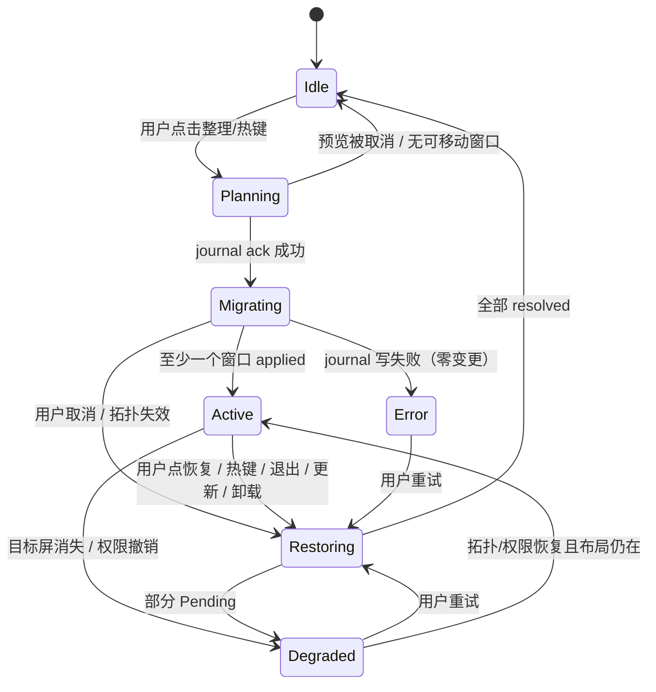

# Unfy v1 实现计划

范围依据：[plan.md](plan.md) 的 D1–D4 决策 —— Windows + macOS、纯手动触发、冲突感知恢复、无商业化。
本文只写**怎么建**，不重复 PRD 的验收用例（见 [spec/product-spec.md](spec/product-spec.md) §5.4）与数据模型（见 [spec/technical-design.md](spec/technical-design.md) §3）。

---

## 1. 工作区结构

Cargo workspace + 单 Tauri app。核心 crate 不依赖 Tauri，保证可无头单测。

```
Unfy/
├─ Cargo.toml                     # [workspace] members
├─ apps/desktop/
│  ├─ package.json                # React 19 + Vite + Tailwind + shadcn/ui
│  ├─ src/                        # 3 个页面 + 托盘菜单的前端投影
│  └─ src-tauri/
│     ├─ Cargo.toml               # tauri, tauri-plugin-updater, tauri-plugin-global-shortcut
│     ├─ tauri.conf.json
│     ├─ capabilities/default.json
│     └─ src/{main,commands,state,tray}.rs
├─ crates/
│  ├─ domain/                     # 无 OS 依赖：WindowId, DisplayId, Rect, WindowMode, EngineState, ErrorCode
│  ├─ layout/                     # 纯函数：快照 → 槽位计划；property tests
│  ├─ journal/                    # 事务写入、原子替换、崩溃恢复读取
│  ├─ engine/                     # 单写者协调器：preview → migrate → settle → restore
│  ├─ platform/                   # trait 定义 + 能力矩阵
│  │  ├─ win/                     # windows-rs
│  │  ├─ mac/                     # objc2 + objc2-app-kit + core-graphics FFI
│  │  └─ fake/                    # 内存实现，供 engine/journal/layout 测试
│  └─ diag/                       # 结构化日志 + 脱敏导出
└─ tests/
   ├─ fixtures/                   # journal 二进制样本、窗口快照 JSON
   └─ e2e/                        # 需要真实桌面的手动清单（非 CI）
```

依赖方向严格单向：`domain ← layout ← engine ← platform/*`，`journal` 只依赖 `domain`。`platform` 不得反向依赖 `engine`。

---

## 2. 平台抽象

```rust
// crates/platform/src/lib.rs
pub trait DisplayProvider {
    fn topology(&self) -> Result<Topology, PlatformError>;
    fn subscribe(&self, cb: Box<dyn Fn(TopologyEvent) + Send + Sync>) -> Result<Sub, PlatformError>;
}

pub trait WindowBackend {
    fn enumerate(&self) -> Result<Vec<WindowSnapshot>, PlatformError>;
    fn capabilities(&self, w: &WindowId) -> Capabilities;      // 可移动/可缩放/可读状态
    fn apply(&self, w: &WindowId, plan: &WindowPlan) -> Result<(), PlatformError>;
    fn read_back(&self, w: &WindowId) -> Result<ObservedWindow, PlatformError>;
    fn observe_changes(&self, cb: Box<dyn Fn(WindowEvent) + Send + Sync>) -> Result<Sub, PlatformError>;
}
```

设计约束（每条都有核查依据，见 [verify/](verify/)）：

| 约束 | 原因 |
|---|---|
| `apply` 与 `read_back` 分离，中间不 sleep 在调用线程 | 跨进程调用可能阻塞数百毫秒；回读要异步/分批 |
| `Capabilities` 由平台在枚举时给出，不由调用方猜 | macOS 需 `AXUIElementIsAttributeSettable` 探测；Windows 需判断 UIPI |
| `WindowSnapshot` 同时带 native placement 与物理矩形 | Windows `WINDOWPLACEMENT` 是 workspace 坐标，不能直接给 `SetWindowPos` |
| 显示器 ID 用稳定键，不用索引 | `HMONITOR` 在 `WM_DISPLAYCHANGE` 后失效；macOS display ID 会话内稳定但需 UUID 持久化 |
| 所有写操作幂等 | 崩溃恢复会重放同一 intent |

---

## 3. 精简状态机

去掉自动检测后只剩 7 个状态。`Armed`/`Detecting` 与规则引擎一起删除。



关键规则：

- `Planning` 只读不写，允许反复预览；进入 `Migrating` 的前提是 journal 已 durable。
- `Active` 没有"倒计时"——纯手动模式下断开由用户自己判断。`Active` 只提供"恢复本次布局"。
- 任何进入 `Restoring` 的路径都必须先冻结新写入。
- `Error` 只表示"无法安全继续"，不是"操作失败"；单个窗口失败记 `WindowOutcome`，不改变全局状态。

---

## 4. 迁移管线（一次点击的完整链路）

```text
1. 采集   enumerate() → 过滤 → 分组(owner) → 能力探测
2. 规划   layout::plan(windows, target_display, config) → Vec<WindowPlan>
          （纯函数，输出槽位 rect + 状态变换，可预览）
3. 落盘   journal::prepare(txn_id, preimages, plans) → durable ack
4. 提交   分批 apply()，每批 ≤16 窗口，批间检查取消令牌与拓扑 generation
5. 回读   settle：等待 observed 稳定；偏差 >2px 且 attempt<3 → 重试该窗口
6. 收敛   写 results；任一 applied → Active；全部 skipped → Idle + 原因列表
```

过滤规则（与规格 §6.1 一致，此处只列 v1 必须实现的）：

| 跳过条件 | Windows | macOS |
|---|---|---|
| 本进程窗口 | PID 相等 | PID 相等 |
| 不可见/零尺寸/cloaked | `IsWindowVisible`、`DWMWA_CLOAKED` | `kAXMinimizedAttribute` 之外的零尺寸 |
| 工具窗 | `WS_EX_TOOLWINDOW` | `kAXSubroleAttribute` ≠ 标准窗口 |
| 系统外壳 | 类名 `Shell_TrayWnd`/`Progman`/`WorkerW` | bundle id `com.apple.dock`/`com.apple.finder`(桌面层) |
| 提权窗口 | 目标进程完整性 > 本进程 → 跳过 | — |
| 原生全屏 | 覆盖整屏且 `WS_POPUP` | `"AXFullScreen" == true` |
| 其他虚拟桌面 | `IVirtualDesktopManager::IsWindowOnCurrentVirtualDesktop` | 其他 Space（AX 不可见即自然跳过） |
| 模态子窗口 | owner 非空 → 随 owner 移动，不单独占槽 | `kAXParentAttribute` 非空同理 |

---

## 5. Journal 格式

单文件 append-only + checkpoint，路径 `%APPDATA%\Unfy\state\journal\`（macOS：`~/Library/Application Support/Unfy/`）。

```
记录 = [len:u32][crc32:u32][type:u8][payload:json]
type: 1=Begin 2=Preimage 3=Intent 4=Result 5=Closed 6=Abandon
```

规则：

- `Begin` 与所有 `Preimage` 必须在第一个 `Intent` 之前刷盘。
- `Result` 记录 `WindowOutcome`（`Applied` / `Rejected` / `ExternallyModified` / `WindowGone`）。
- `Closed` 才允许删除文件；未 `Closed` 的文件在启动时被扫描。
- 尾部截断/CRC 失败 → 保留原文件为 `.corrupt`，进入 `Error`，只允许"救援越界窗口"，不做原位恢复。
- 文件大小上限 10 MiB；超限拒绝新事务（不淘汰未恢复记录）。

---

## 6. 任务序列

按依赖排序。每个任务都要有可演示的产出，不写"基础设施"这类无法验收的任务。

| # | 任务 | 产出 | 验收 | 预估 |
|---|---|---|---|---|
| T0 | Rust 工具链 + Tauri 骨架 | `cargo tauri dev` 能起窗口，托盘图标可见 | 应用启动/退出无报错 | 0.5 天 |
| T1 | `domain` + `layout` + Fake | 类型、布局纯函数、Fake backend | 属性测试：100 窗、负坐标、竖屏、混合缩放、最小尺寸约束 | 2 天（domain+Fake 已完成） |
| T2 | `journal` | 写入/恢复/损坏降级 | 已完成：真实强杀 4 次 + 截断/损坏/乱码尾部测试，恢复始终是完整前缀 | 2 天（完成） |
| T3 | `platform/win` | 枚举、能力、apply、read_back | 真机：跨进程往返偏差 ≤4px（**已完成，实测 0 px**）；混合 DPI 与提权窗口待补 | 4 天（主体完成） |
| T4 | `engine` + 命令面 | preview/migrate/restore 全链路 | 已完成：17 个行为测试 + 真实桌面 e2e（迁移/恢复/崩溃接管） | 3 天（完成） |
| T5 | `platform/mac` | AX 枚举、读写、TCC 检测 | 真机：TCC 授权后移动 Finder/浏览器窗口；未授权时 UI 正确降级 | 5 天 |
| T6 | UI（3 页）+ 托盘 + 热键 | 概览/目标屏与布局/通用 | 已完成：真实 UI 走通预览/整理/恢复/权限横幅 | 3 天（完成） |
| T7 | `diag` + updater + 打包 | 日志、脱敏导出、NSIS/DMG | NSIS 安装/卸载已实测；更新与公证未验证（无证书/端点） | 2 天（部分完成） |

总计约 22 人日（不含 M0 探针）。T3 与 T5 可并行；T1/T2 无平台依赖可先做。

---

## 7. 风险闸门

| 闸门 | 位置 | 不通过时 |
|---|---|---|
| G1 | T1 结束 | 布局算法在 100 窗下 p95 >20ms → 降级为简单网格 |
| G2 | T2 结束 | 断电测试出现一次不可恢复 → 停止 T4，重做持久化 |
| G3 | T3 结束 | 应用自我纠正率 >10% → 该应用加入默认排除名单，不强行重试 |
| G4 | T5 结束 | 沙箱/TCC 导致核心应用不可控 → macOS 版标注"部分支持"，不隐瞒 |
| G5 | T7 结束 | 升级后恢复屏障失败 → 关闭自动更新，只留手动下载 |

---

## 8. 明确不做（v1）

自动检测与规则包、Linux、Wayland、虚拟显示器、强制单屏、特权 helper、License/支付、自定义布局模板、多远程仲裁、企业策略、遥测上传、i18n（先 zh-CN，英文界面留到内测后）。
